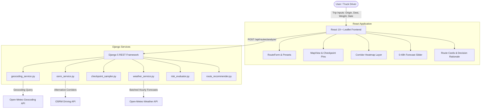

# WeatherRoute — Weather-Aware Truck Routing

[](https://www.djangoproject.com/)
[](https://react.dev/)
[](https://leafletjs.com/)
[](https://open-meteo.com/)
[](https://docs.pytest.org/)

A full-stack web application designed for commercial truck drivers and dispatchers that evaluates multiple routing corridors, predicts localized meteorological conditions at the truck's estimated time of arrival (ETA), applies gross vehicle weight stability rules, and recommends the safest route.

Built for the **Spotter Full Stack Developer Technical Assessment**.

---

## 📋 Table of Contents
- [Project Overview](#-project-overview)
- [Requirements & Feature Mapping](#-requirements--feature-mapping)
- [Architecture & Design](#-architecture--design)
- [Risk Rules & Decision Hierarchy](#-risk-rules--decision-hierarchy)
- [Quick Start Guide](#-quick-start-guide)
  - [Prerequisites](#prerequisites)
  - [Option A: Local Development](#option-a-local-development)
  - [Option B: Docker Compose (1-Command Startup)](#option-b-docker-compose-1-command-startup)
- [API Reference](#-api-reference)
- [Automated Testing](#-automated-testing)
- [Loom Walkthrough Script](#-loom-walkthrough-script)

---

## 🌟 Project Overview

Commercial semi-trucks are susceptible to high crosswind instability and severe weather rollovers, particularly when hauling heavy gross loads. Standard consumer navigation engines solely prioritize transit speed or distance. **WeatherRoute** introduces a safety-first paradigm:

1. **Generates 3 route options** between any origin and destination via OSRM.
2. **Samples checkpoints every 10, 25, or 50 miles**, calculating cumulative distance and localized truck arrival ETAs.
3. **Pulls time-shifted weather forecasts** (Wind, Rain, Snow, Temperature) corresponding to the exact hour the truck arrives at each coordinate.
4. **Applies weight-sensitive load rules** that elevate risk tiers when crosswinds intersect with heavy trailers ($>30,000$ lb and $>40,000$ lb).
5. **Ranks candidate routes** using a strict 4-tier decision hierarchy, highlighting the single safest route with transparent rationale.
6. **Renders an interactive corridor heatmap** with a **0–48 hour forecast slider** allowing drivers to scrub time forward or play an animated sequence.

---

## ✅ Requirements & Feature Mapping

| PDF Requirement | Status | Implementation Details |
| :--- | :---: | :--- |
| **Origin & Destination inputs** | Completed | Autocomplete city search with coordinate parsing support. |
| **Departure date/time input** | Completed | Date-time picker calculating cumulative milestone ETAs. |
| **Load weight input** | Completed | Numerical input with quick presets ($15\text{k}, 28\text{k}, 35\text{k}, 44\text{k}$ lb) and rule alert banner. |
| **Generate 3 route options** | Completed | OSRM routing engine querying highway alternatives and geometric corridors. |
| **Sample weather every 10/25/50 mi** | Completed | User-configurable interval button; Haversine interpolation along polyline. |
| **Calculate weather risk with load rules** | Completed | `risk_evaluator.py`: Wind, rain, snow thresholds + $>30\text{k}$ lb & $>40\text{k}$ lb stability penalties. |
| **Recommend best route** | Completed | `route_recommender.py`: Lexicographical ranking (Fewest Severe $\to$ Fewest High $\to$ Lowest Avg $\to$ Shortest Time). |
| **Interactive Map with popups** | Completed | Leaflet map with CartoDB/Esri Dark canvas, colored checkpoint pins, and ETA popups. |
| **Weather Heatmap + 0–48h Slider** | Completed | `WeatherHeatmapLayer.jsx` with scrubber slider, play/pause controls, and mode switching. |

---

## 🏗️ Architecture & Design



---

## ⚖️ Risk Rules & Decision Hierarchy

### 1. Base Weather Thresholds

| Condition | Low | Moderate | High | Severe | No Travel |
| :--- | :--- | :--- | :--- | :--- | :--- |
| **Wind Speed** | $< 25\text{ mph}$ | $25 – 34\text{ mph}$ | $35 – 44\text{ mph}$ | $45 – 54\text{ mph}$ | $\ge 55\text{ mph}$ |
| **Rain Rate** | $< 0.10\text{ in/hr}$ | $0.10 – 0.25\text{ in/hr}$ | $0.25 – 0.50\text{ in/hr}$ | $0.50 – 1.00\text{ in/hr}$ | $> 1.00\text{ in/hr}$ |
| **Snow Rate** | $< 0.5\text{ in/hr}$ | $0.5 – 1.0\text{ in/hr}$ | $1.0 – 2.0\text{ in/hr}$ | $2.0 – 3.0\text{ in/hr}$ | $> 3.0\text{ in/hr}$ |

### 2. Load Weight Rules (Crosswind Penalties)
- $\mathbf{\ge 55\text{ mph}}$: **No Travel** for *any* load weight.
- $\mathbf{45 – 54\text{ mph}} + \mathbf{> 30,000\text{ lb}}$: Elevated to **No Travel** *(normally Severe)*.
- $\mathbf{35 – 44\text{ mph}} + \mathbf{> 40,000\text{ lb}}$: Elevated to **Severe** *(normally High)*.

### 3. Route Recommendation Preference Order
Candidate routes are sorted according to a strict 4-tuple comparison key:
$$\text{Rank Key} = (\text{No Travel Miles}, \text{Severe Miles}, \text{High Miles}, \text{Average Risk Score}, \text{Travel Time})$$

The winning route is marked as **Recommended** with transparent rationale.

---

## 🚀 Quick Start Guide

### Prerequisites
- Python 3.10+
- Node.js 18+ and npm
- (Optional) Docker & Docker Compose

### Option A: Local Development

#### 1. Start Backend (Django)
```bash
# In project root
python -m venv venv

# Windows:
.\venv\Scripts\activate
# macOS/Linux:
source venv/bin/activate

# Install dependencies
pip install -r backend/requirements.txt

# Run migrations & start server
cd backend
python manage.py migrate
python manage.py runserver 127.0.0.1:8000
```
Backend will be live at `http://127.0.0.1:8000/`.

#### 2. Start Frontend (React + Vite)
```bash
# In a new terminal window
cd frontend
npm install
npm run dev
```
Frontend will be live at `http://127.0.0.1:5173/`.

---

### Option B: Docker Compose (1-Command Startup)

```bash
docker compose up --build
```
- Frontend: `http://localhost/`
- Backend API: `http://localhost:8000/api/`

---

## 📡 API Reference

### 1. Analyze Routes
`POST /api/routes/analyze/`

#### Request Payload
```json
{
  "origin": "Chicago, IL",
  "destination": "Denver, CO",
  "departure_time": "2026-10-15T08:00:00Z",
  "load_weight_lb": 35000,
  "sampling_interval_miles": 25
}
```

#### Response Summary
```json
{
  "origin": { "name": "Chicago, IL, USA", "lat": 41.8781, "lng": -87.6298 },
  "destination": { "name": "Denver, CO, USA", "lat": 39.7392, "lng": -104.9903 },
  "routes": [
    {
      "id": "route_1",
      "name": "Primary Highway (Route A)",
      "rank": 1,
      "is_recommended": true,
      "recommendation_rationale": "Safely avoids all Severe/No-Travel conditions | Lowest average corridor risk score of 1.15/5.0",
      "distance_miles": 1005.1,
      "duration_formatted": "17h 48m",
      "metrics": {
        "no_travel_miles": 0.0,
        "severe_miles": 0.0,
        "high_miles": 0.0,
        "moderate_miles": 125.0,
        "low_miles": 880.1,
        "average_risk_score": 1.15
      },
      "checkpoints": [ ... ]
    }
  ]
}
```

---

## 🧪 Automated Testing

The backend includes a comprehensive `pytest` test suite covering:
- Exact risk threshold classification (wind, rain, snow).
- Load weight penalty triggers ($>30\text{k}$ lb and $>40\text{k}$ lb).
- Haversine geodesic distance calculations and arrival ETA interpolation.
- Recommendation hierarchy tie-breaking logic.
- REST API contracts and input validation.

To run tests:
```bash
cd backend
pytest
```
*Current test results: **16 passed in 0.08s**.*

---

## 🎥 Loom Walkthrough Script

A detailed, timed 5–10 minute video recording script is available in [LOOM_WALKTHROUGH_SCRIPT.md](file:///e:/Antigravity_workspace/weatherroute/LOOM_WALKTHROUGH_SCRIPT.md).
